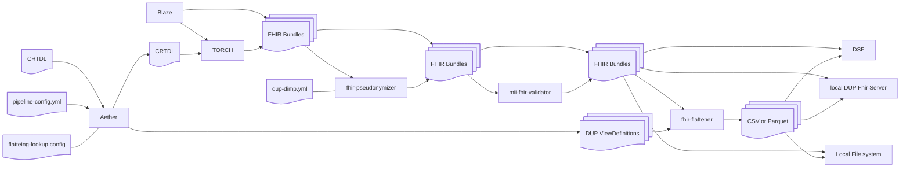

# aether DUP pipeline coordinator

The DUP pipeline requires a Data Node to be set up with all the services required by the pipeline.

Please refer to the architecture of a data node [here](architecture.md) and a list of all the data node services [here](overview.md)

## Installing and using aether as part of the Data Node

To install aether follow the installation instruction [here](https://medizininformatik-initiative.github.io/aether/getting-started/installation.html)

For version compatibility with the dataportal [see](https://medizininformatik-initiative.github.io/dataportal/compatibility-matrix.html)

### Setting up aether

To use aether all the services which aether is using for your pipeline need to be set up - see pipeline steps above.

Additionally, to flatten data aether needs a `flatteningLookup.json` file, which can be downloaded for the the newest ontology published for the data node.

To download flatteningLookup of a particular ontology version, use the `get_flattening_lookup.sh` of this repository - see [here](https://github.com/medizininformatik-initiative/dataportal/blob/main/data-node/aether/get_flattening_lookup.sh).

### Using aether

Aether uses a .yml config file which allows you to configure which steps should be included in your DUP pipeline.

Example call for aether in this context once installed - calling from the [example directory ](https://github.com/medizininformatik-initiative/dataportal/tree/main/data-node/aether) `aether pipeline start base-pipeline-config.yml queries/example-crtdl.json`

It creates a job directory, which for each DUP project saves the output of each step, so that one can branch of or review the output from each step.

To see all the configuration options see [base-pipeline-config.yml](https://github.com/medizininformatik-initiative/dataportal/blob/main/data-node/aether/base-pipeline-config.yml).

### The DUP Reference Pipeline Detailed

Zooming in the more detailed pipeline can be depicted as follows:

## aether use - General

See aether documentation [here](https://medizininformatik-initiative.github.io/aether/).

For an example configuration see the base configuration in our example setup [here](https://github.com/medizininformatik-initiative/dataportal/blob/main/data-node/aether/base-pipeline-config.yml).

### aether simple example to get started

First install aether locally following the install instructions [here](https://medizininformatik-initiative.github.io/aether/getting-started/installation.html).

To get started using aether configure a simple pipeline as shown [here](https://github.com/medizininformatik-initiative/dataportal/blob/main/data-node/aether/base-pipeline-config-simple.yml).

and then run aether using `aether pipeline start base-pipeline-config-simple.yml queries/example-crtdl.json` in the [aether folder](https://github.com/medizininformatik-initiative/dataportal/tree/main/data-node/aether) of your data node.

Aether will run and then tell you the ID of your job e.g. `Job ID: 20260331_0915_5932b1e1-0ed5-4bab-902e-25f328209390`, which directly corresponds to a folder in your `jobs` directory. 

For this simple example you will find your extracted data in the `import` folder in the directory of your specific job.

Note that aether always creates all necessary folders for all supported steps:

1. import (TORCH export directory)
2. dimp (pseudonymized data from the DIMP step)
3. validation (output information from the validation step - note this does not contain the data but validation results instead)
4. viewdefinitions (ViewDefinitions generated for the flattening step)
5. csv (flattened output if csv is chosen)
6. send (information about the send step)

The job directory also contains the job log (`job.log`), the CRTDL used for the job (`enriched-crtdl.json`) and the job state (`state.json`).

